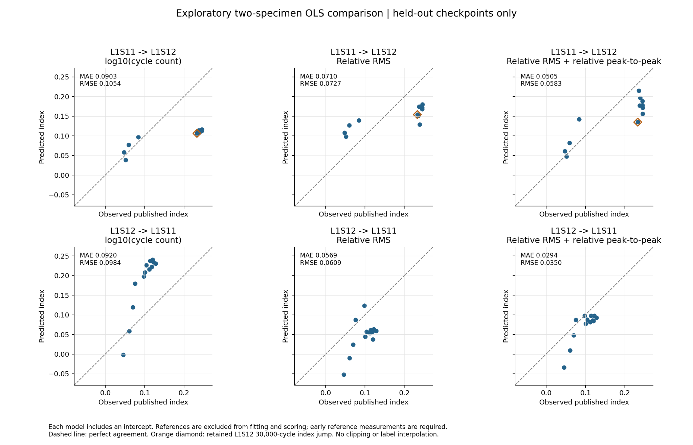

# MMA3001: composite fatigue and ultrasonic stiffness estimation

An exploratory engineering project investigating whether reference-normalised ultrasonic features estimate a published stiffness-degradation index better than a cycle-count baseline.

**Current stage:** the first two-specimen regression experiment is complete. This repository collects the work already performed; its initial import does not recreate an earlier Git history.

## Question and scope

Can a linear model using relative RMS and relative peak-to-peak amplitude from one ultrasonic path transfer between two CFRP specimens more accurately than a model using log-cycle count?

- Dataset: NASA composites fatigue data; specimens **L1S11 and L1S12**, Layup 1.
- Input: actuator 1 to receiver 7, nominal 150 kHz, loaded near 4 kips.
- Target: existing `coupon.straingage_data.stiffness_degradation` values. These are published index candidates, not newly validated modulus measurements.
- Evaluation: fit on one specimen and evaluate on the other, then reverse.
- Deployment assumption: an early reference waveform is available for each specimen. It is not assumed undamaged, and its target is not used for calibration.

## Quick start: reproduce the regression without downloading the raw dataset

Run these commands **from this repository**, not the folder containing the NASA data. On Windows PowerShell:

```powershell
py -m venv .venv
.\.venv\Scripts\python.exe -m pip install -r requirements.txt
.\.venv\Scripts\python.exe scripts/reproduce_results.py
.\.venv\Scripts\python.exe -m unittest discover -s tests -v
```

On Linux or macOS:

```bash
python3 -m venv .venv
.venv/bin/python -m pip install -r requirements.txt
.venv/bin/python scripts/reproduce_results.py
.venv/bin/python -m unittest discover -s tests -v
```

The replay reads the included checkpoint table and writes new CSVs under `results/reproduced/`. It does not alter the recorded first experiment. It reproduces regression calculations, **not extraction of features from the original waveforms**.

## Rebuild from the NASA files

Keep the original downloaded dataset outside this repository. Pass the **directory containing `Layup1`**, usually named `2. Composites`:

```powershell
.\.venv\Scripts\python.exe scripts/exploratory_regression.py --data-root "D:\path\to\2. Composites"
```

Replace the example path with your actual extracted dataset directory. No re-extraction or moving the NASA files is required. Outputs go to `results/rebuilt/`. The script refuses an output directory within the original data or the recorded baseline.

See [data setup](data/README.md) for the source and expected layout. The raw-data entry point has been made portable; full extraction still needs to be rerun on the student's machine because the MAT files are not included here.

## First experiment

14 labelled nonzero-cycle checkpoints were retained for L1S11 and 13 for L1S12. Removing one reference per specimen leaves **13 and 12 checkpoints** for fitting/scoring. Multiple checkpoints from one specimen remain correlated.

| Train → evaluate | Model inputs | MAE | RMSE |
|---|---|---:|---:|
| L1S11 → L1S12 | log10(cycles) | 0.090299 | 0.105431 |
| L1S11 → L1S12 | Relative RMS | 0.071013 | 0.072705 |
| L1S11 → L1S12 | Relative RMS + relative peak-to-peak | **0.050532** | **0.058254** |
| L1S12 → L1S11 | log10(cycles) | 0.092013 | 0.098381 |
| L1S12 → L1S11 | Relative RMS | 0.056906 | 0.060876 |
| L1S12 → L1S11 | Relative RMS + relative peak-to-peak | **0.029357** | **0.035001** |

Errors are in published-index units. The two-feature model reduces MAE by about 44% and 68% relative to the chosen cycle-count model. These are error reductions, not accuracy percentages. Substantial bias remains, and one two-feature prediction is negative.



## Project files

| Location | Purpose |
|---|---|
| `scripts/exploratory_regression.py` | Rebuild features, models and plots from the external MAT dataset |
| `scripts/reproduce_results.py` | Independently refit the exported features using centred QR |
| `results/baseline/` | Recorded first experiment: features, references, predictions, metrics and plot |
| `tests/` | Scientific-result reproduction and checks against target leakage |
| `docs/methodology.md` | Selection rules, equations and validation design |
| `docs/progress.md` | Completed work and remaining tasks |
| `docs/ai-use.md` | Record of AI assistance, for student review |
| `docs/github-setup.md` | Creating the private GitHub remote and normal commit workflow |
| `archive/` | Earlier exploratory scripts, figures and audit summaries |

## Limitations

- Only two labelled specimens in the primary experiment; no broad validation across layups, remaining-useful-life prediction or verified failure-time model.
- A nominal 150 kHz signal produces a roughly 15 kHz FFT peak using the stored 1.2 MHz rate. Physical timing is unresolved. Current features use sample indices and do not claim a physical time-of-flight.
- L1S11 uses gain/excitation settings 33/65; L1S12 uses 35/50. Reference ratios remove only constant multiplicative effects under that assumption, not all acquisition differences.
- The L1S12 20,000-cycle label is missing. A label jump after 10,000 cycles is retained and flagged. Targets have not been independently reconstructed from calibrated force-strain data.
- Features and models were explored interactively. This is a development experiment, not a sealed final benchmark. Future model selection should disclose this exploration.
- Checking finite/nonconstant signals does not establish complete waveform quality or absence of clipping.

## Reproducibility and attribution

Numerical replay and tests were checked with Python 3.12.14, NumPy 2.3.5, SciPy 1.17.0 and Matplotlib 3.10.8. `requirements.txt` gives compatible ranges, not an exact environment lock. Automated checks are local; a GitHub-hosted CI run is not claimed.

Dataset source: [NASA PCoE Data Set Repository](https://www.nasa.gov/intelligent-systems-division/discovery-and-systems-health/pcoe/pcoe-data-set-repository/). The local technical report, README files and logbooks control file-level interpretation. See [data/README.md](data/README.md) and [AI assistance](docs/ai-use.md).

The MIT licence covers original project code and documentation; third-party dataset material and underlying data rights are not relicensed. Raw MAT files, experimental workbooks and source papers are excluded from this repository.
