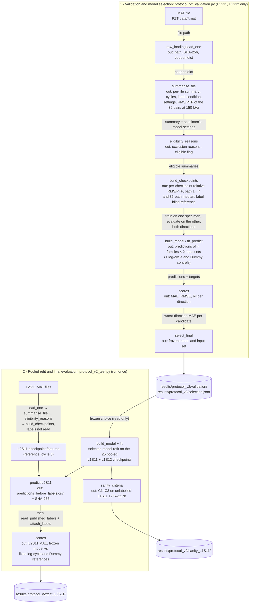

# MMA3001: ultrasonic features and composite stiffness degradation

An exploratory feasibility study for MMA3001 (Monash, Numerical Methods and Machine Learning).
**Question:** can simple ultrasonic (PZT Lamb-wave) amplitude features estimate the published
stiffness-degradation index of a CFRP fatigue coupon, using a regression model trained on a
*different* coupon?

**Answer from this study: no evidence that the frozen model transfers to L2S11.** On the
held-out cross-layup specimen L2S11, the frozen model (linear regression on path 1→7) has MAE
0.0374. By the predeclared rule it beats log-cycle OLS (0.0946) and a training-mean baseline
(0.1015), but only because those controls carry Layup 1's higher target level. A post hoc
predict-zero baseline scores MAE 0.0362, slightly better. Path 1→7 barely responds on L2S11, and
the 36-path features change strongly but on different scales in each development specimen.
Crosstalk on path 1→7, mounting or coupling changes, and specimen (layup, load) effects are
hypotheses consistent with these data, not established causes. One frozen model was tested on one
specimen, so this does not show that amplitude features cannot transfer in general.

## Contents

1. [Engineering problem, inputs and outputs](#engineering-problem-inputs-and-outputs)
2. [Results at a glance](#results-at-a-glance)
3. [Pipeline (protocol v2)](#pipeline-protocol-v2)
4. [Repository structure](#repository-structure)
5. [Setup](#setup)
6. [Data download](#data-download)
7. [Reproduce](#reproduce)
8. [Tests and checks](#tests-and-checks)
9. [Documentation](#documentation)
10. [Limitations](#limitations)
11. [Attribution and licence](#attribution-and-licence)
12. [AI use and reflection](#ai-use-and-reflection)

## Engineering problem, inputs and outputs

- **Context.** CFRP laminates lose stiffness under fatigue through matrix cracking and
  delamination. Permanently bonded PZT networks could monitor that loss without stopping a
  structure for mechanical testing, if their signals can be mapped to stiffness loss in a way that
  carries over from one part to another.
- **Data.** The NASA PCoE "CFRP Composites" dataset (Saxena et al.). Notched T700G coupons in
  tension–tension fatigue, with two 6-PZT SMART Layer strips (36 actuator–sensor paths × 7
  frequencies). Only three coupons carry published stiffness labels: **L1S11, L1S12** (Layup 1,
  development) and **L2S11** (Layup 2, held-out test).
- **Inputs.**
  - Receiver waveforms (2,000 samples, raw acquisition units) at 150 kHz, in the Loaded condition
    at the specimen's fatigue mean load.
  - Each feature is the checkpoint median over repeat recordings, divided by the same quantity at
    the specimen's earliest eligible checkpoint, so it is dimensionless.
  - Two input sets: relative RMS and relative peak-to-peak of **path 1→7**, or the **median of the
    36 per-path ratios**.
- **Output.** An estimate of `coupon.straingage_data.stiffness_degradation`, a published index
  that is best interpreted as normalised stiffness loss 1 − E/E₀. Errors are reported in index
  units; MAE is primary.
- **Invalid or unsupported inputs.** Recordings outside the load window, with the wrong condition,
  a missing or duplicated path, or changed gain or amplitude settings are excluded and counted,
  never repaired. Protocol v2 also excludes nonfinite or constant signals on either channel. The
  historical v1 screening only flags them; this does not affect any recorded result, because none
  of the 51 eligible v1 recordings is flagged. Missing labels stay missing and are never
  interpolated. The reference checkpoint is never scored.
- **Intended use and limits.** This is a feasibility test of transfer between specimens, not a
  validated structural-health-monitoring tool. See [docs/dataset.md](docs/dataset.md) for the
  label definition, the sampling-rate correction (stored 1.2 MHz; actual about 12 MHz) and
  amplitude units.

## Results at a glance

All numbers are copied from files under `results/`.

**v1 comparison (predeclared, `results/model_comparison/`).** Path 1→7, train on one Layup 1
coupon and evaluate on the other.

| Model | MAE L1S11 → L1S12 | MAE L1S12 → L1S11 |
|---|---:|---:|
| LinearRegression | 0.0505 | 0.0294 |
| DecisionTreeRegressor (depth 2) | 0.1052 | 0.0458 |
| RBF SVR | 0.1112 | 0.0563 |
| MLP (3 tanh units), median of 5 seeds | 0.0782 | 0.0209 |
| log-cycle OLS (control) | 0.0903 | 0.0920 |
| training-mean Dummy (control) | 0.1077 | 0.0831 |

**Protocol v2 validation (`results/protocol_v2/validation/`).** The multi-path input lowered the
worst-direction MAE of the tree (0.1052 to 0.0907) and SVR (0.1112 to 0.0963), raised it for linear
regression and the MLP, and no multi-path candidate came close to single-path linear regression.
The predeclared rule (lowest worst-direction MAE) selected **LinearRegression on path 1→7**
(0.0505). The single-path scores were already known from
v1 when that rule was written.

**Held-out test on L2S11, scored once (`results/protocol_v2/test_L2S11/`).**

| Model | L2S11 MAE | Note |
|---|---:|---|
| Frozen LinearRegression, path 1→7 | 0.0374 | every prediction below its observation; R² −2.27 |
| log-cycle OLS (control) | 0.0946 | predeclared reference point |
| training-mean Dummy (control) | 0.1015 | predeclared reference point |
| predict zero (post hoc) | 0.0362 | not predeclared; shows the controls' bias |

All 16 non-reference L2S11 checkpoints lie outside the training feature hull. The unlabelled L1S11
sanity check (125k–227k cycles) **fails** criterion C1. A post hoc diagnostic links the failure to
a jump at 177k cycles that appears on all 36 paths at once. This is consistent with a coupling
or mounting change, but that cause is not confirmed (`results/protocol_v2/sanity_L1S11/`).

**Recommendations.** Use features that isolate the transmitted wave (S0-mode windowing, time of
flight, ΔPSD as in Saxena et al. 2011), add more labelled specimens, or calibrate per specimen.

## Pipeline (protocol v2)

Function names are from `scripts/`; each box gives a step's main output. The model was selected
using L1S11 ↔ L1S12 validation only. `selection.json` was committed before `protocol_v2_test.py`
ran, and the L2S11 scores are never used to choose a model.



Stage 2 only reads `selection.json`; nothing flows back from stage 2 to stage 1. The v1 workflows
(`exploratory_regression.py`, `model_comparison.py`) follow the same extract → checkpoint → fit →
score pattern on path 1→7 alone.

## Repository structure

| Path | Contents |
|---|---|
| `scripts/` | All code: one module per workflow, plus `common.py` (shared checks and I/O) |
| `tests/` | Unit and reproduction tests, run with pytest |
| `config/` | Frozen settings: `experiment_v1.json`, `model_comparison.json`, `protocol_v2.json` |
| `docs/protocol_v2.md`, `docs/model_comparison_protocol.md` | Protocols written before their scores |
| `docs/methodology.md`, `docs/dataset.md` | Methods; dataset provenance, label definition, sampling rate, units |
| `docs/progress.md` | Dated log of every working session |
| `docs/html/` | Generated API documentation (pdoc) |
| `results/baseline/` | First experiment (v1 OLS), recorded |
| `results/repeat_sensitivity/` | Median / first / last repeat sensitivity |
| `results/model_comparison/` | v1 six-model comparison, coverage, timing, profiling |
| `results/protocol_v2_audit/` | Label-blind acquisition audit behind protocol v2 |
| `results/protocol_v2/` | v2 validation, frozen selection, L2S11 test, sanity check, post hoc notes |
| `results/dataset_facts/` | Label links, strain-file contents and FFT sampling-rate check |
| `results/reproduction_check/`, `results/test_report/` | Reproduction reports and pytest reports |
| `results/memory_profile/` | Peak traced memory (tracemalloc) of extraction and fit+predict |
| `archive/` | Earlier exploratory scripts and the label audit (`archive/audit/ASSESSMENT.md`) |
| `data/README.md` | Where the raw data must be placed; the raw download is git-ignored |
| `data/audit_stiffness/`, `data/pzt_feasibility/` | Historical, unmaintained: derived label-audit and feasibility tables, figures and notebooks (raw and third-party material untracked; see [docs/dataset.md](docs/dataset.md)) |

## Setup

Requires Python 3.13; the results were produced with CPython 3.13.3 on Windows 11.

```powershell
py -3.13 -m venv .venv
.\.venv\Scripts\python.exe -m pip install -r requirements-lock.txt
```

`requirements-lock.txt` pins the exact versions that produced the recorded results.
`requirements.txt` (runtime) and `requirements-dev.txt` (pytest, pytest-html, pdoc) give compatible
ranges. On Linux or macOS use `python3 -m venv .venv` and `.venv/bin/python`.

## Data download

1. Download `https://phm-datasets.s3.amazonaws.com/NASA/2.+Composites.zip`, the link listed on the
   [NASA PCoE Data Set Repository](https://www.nasa.gov/intelligent-systems-division/discovery-and-systems-health/pcoe/pcoe-data-set-repository/)
   (checked 2026-10-11).
2. Extract it so that `data/2.+Composites/2. Composites/` contains `Layup1`, `Layup2` and
   `Layup3`. Any other location works if you pass it as `--data-root`.
3. Do not modify or commit the files. `.gitignore` excludes them, and the workflows check that. Raw
   and third-party material once committed by the early audit was untracked on 2026-10-12 but
   remains in earlier commits; see [docs/dataset.md](docs/dataset.md).

The no-data replay and most tests need no download.

## Reproduce

Run everything from the repository root with the project environment's interpreter. The examples
use PowerShell. On Linux or macOS, replace `.\.venv\Scripts\python.exe` with `.venv/bin/python`,
and `$D` with `"$D"` after `D="data/2.+Composites/2. Composites"`.

```powershell
$D = "data/2.+Composites/2. Composites"
$py = ".\.venv\Scripts\python.exe"
```

**What may be overwritten.** Recorded results (`results/baseline`, `repeat_sensitivity`,
`model_comparison`, `protocol_v2`, `protocol_v2_audit`, `reproduction_check`, `dataset_facts`,
`test_report`, `memory_profile`) are never written by any workflow script. Every output option refuses them, and the
defaults are under the git-ignored `results/rebuilt/` (or `results/reproduced/`). Rerunning a
command overwrites its own folder under `results/rebuilt/`. `verify_reproduction.py` deletes and
recreates only its `--work` folder, which must lie strictly inside `results/rebuilt/`, and
`protocol_v2_validation.py --replay` deletes and recreates only `results/rebuilt/protocol_v2_replay/`.
Two documented
commands deliberately refresh tracked files: the pytest-report command (`results/test_report/`) and
the docs build (`docs/html/`).

### (a) Verify the recorded v1 results

```powershell
& $py scripts/reproduce_results.py                                # no raw data needed
& $py scripts/verify_reproduction.py --data-root $D
```

- **`reproduce_results.py`.** Refits the recorded baseline features with an independent QR solver
  and writes `results/reproduced/`.
- **`verify_reproduction.py`.** Reruns the baseline extraction, repeat sensitivity, six-model
  comparison and coverage into `results/rebuilt/verification/`. It compares every recorded file and
  writes a report to `results/rebuilt/reproduction_check/report.json`. It fails if any
  deterministic output differs. Timing samples are not compared.
- **Earlier reports.** The recorded reports from earlier runs are in `results/reproduction_check/`.

### (b) Regenerate individual outputs safely

| Workflow | Command | Writes to |
|---|---|---|
| v1 extraction and OLS | `& $py scripts/exploratory_regression.py --data-root $D` | `results/rebuilt/` |
| Repeat sensitivity | `& $py scripts/repeat_sensitivity.py --data-root $D` | `results/rebuilt/repeat_sensitivity/` |
| v1 six-model comparison (with timings) | `& $py scripts/model_comparison.py --data-root $D` | `results/rebuilt/model_comparison/` |
| Coverage diagnostic | `& $py scripts/feature_coverage.py` | `results/rebuilt/coverage/` |
| cProfile of the raw workflow | `& $py scripts/profile_raw_workflow.py --data-root $D` | `results/rebuilt/raw_profile/` |
| Serial vs prefetch benchmark | `& $py scripts/benchmark_raw_workflow.py --data-root $D` | `results/rebuilt/raw_benchmark/` |
| Protocol v2 acquisition audit | `& $py scripts/audit_acquisition_v2.py --data-root $D` | `results/rebuilt/protocol_v2_audit/` |
| Dataset facts (label links, sampling-rate check) | `& $py scripts/dataset_facts.py --data-root $D` | `results/rebuilt/dataset_facts/` |
| Post hoc L2S11 summary (reads saved outputs only) | `& $py scripts/post_hoc_step4.py` | `results/rebuilt/post_hoc_step4/` |
| Post hoc L1S11 logbook diagnostic | `& $py scripts/post_hoc_logbook_l1s11.py --data-root $D` | `results/rebuilt/post_hoc_step4/` |

- **Comparing with the record.** Each output can be compared by hand with its recorded
  counterpart. The audit, dataset facts and both post hoc outputs matched their recorded copies in
  content on 2026-10-12.
- **Timings are not reproducible numbers.** Profiling, benchmark and model-timing outputs are local
  measurements that change with machine load and caches. The recorded 12.77 s → 7.77 s comparison
  was measured once on the author's machine. A later rerun gave different absolute times; only the
  byte-identical outputs of the two modes are a reproducible claim.

### (c) The one-time protocol v2 scripts

`protocol_v2_validation.py` and `protocol_v2_test.py` were each run exactly once, from a clean
commit, to produce `results/protocol_v2/` (receipts in `validation/receipt.json` and
`test_L2S11/receipt.json`). Without extra options both refuse to run while their outputs exist,
and both refuse uncommitted code. Do not delete or edit `results/protocol_v2/`.

**Validation (L1S11 ↔ L1S12): replay it.**

```powershell
& $py scripts/protocol_v2_validation.py --data-root $D --replay
```

- **What it does.** Repeats the whole validation, including the v1 reproduction gate and the
  selection rule. It reads only L1S11 and L1S12.
- **Where it writes.** It deletes and recreates `results/rebuilt/protocol_v2_replay/` (validated
  first, like `--work`) and writes the validation outputs and `selection.json` there.
- **How it checks.** It compares every recorded file in `results/protocol_v2/validation/` and
  `selection.json` with its replayed copy, writes `comparison.json`, and fails if any differs.
- **Not compared.** `receipt.json` (the run's own commit, time and versions) and the hand-written
  `README.md` are not compared. In `selection.json`, only `decided_utc` and
  `validation_git_commit` may differ.
- **No clean tree needed.** The replay does not need a clean tree, because it decides nothing.

**L2S11 test: not rerun.** `protocol_v2_test.py` has no replay mode on purpose. The protocol
scores L2S11 once, and rerunning the script would score it again. To check the recorded test,
inspect `results/protocol_v2/test_L2S11/`:

- the predictions were saved before the labels were read
  (`predictions_before_labels.csv` and its SHA-256);
- the receipt gives the commit and the protocol hashes;
- the metrics can be recomputed from the saved predictions.

The once-only guard is local. It checks for existing output folders and a clean tree, so a clone
with those folders removed and the removal committed would run again. That is how the guard works;
it is not a reproduction route.

## Tests and checks

```powershell
.\.venv\Scripts\python.exe -m pytest                       # all tests
.\.venv\Scripts\python.exe -m pytest --junitxml=results/test_report/junit.xml --html=results/test_report/report.html --self-contained-html
.\.venv\Scripts\python.exe -m black --check scripts tests    # formatting (settings in pyproject.toml)
.\.venv\Scripts\python.exe -m pyflakes scripts tests         # static checks
```

All tools (pytest, pytest-html, pdoc, black, pyflakes) come from `requirements-dev.txt` and are
pinned in `requirements-lock.txt`; nothing relies on a global installation.

- **What the tests cover.**
  - Features on known signals, and the label-blind reference.
  - Each v1 and v2 eligibility rule, including the v2 sampling-rate, signal-length and L2S11
    load-window bounds. v1's flag-only handling of invalid signals is pinned as historical.
  - The multi-path aggregation order, with pairs and repeats that differ.
  - Leakage: changing evaluation or reference targets cannot change predictions.
  - Training-only scaling and the selection rule.
  - The one-to-one v2 reproduction gate, with duplicate, missing and changed rows.
  - The L2S11 once-only guard and the order "predictions written before labels read". These use
    mocked, synthetic data only.
  - The scratch-folder and recorded-output guards, integrity checks under `python -O`, and
    agreement of recorded results with independent recalculation.
- **Docstrings.** Every test class and test method has a docstring stating the property it
  checks: leakage, a guard, or a known answer.
- **Saved reports.** The latest reports are in `results/test_report/`.
- **Reproduction check.** Recorded runs found every deterministic v1 output byte-identical or
  equal in content (`results/reproduction_check/`).
- **Fresh-clone verification.** A fresh clone with a new virtual environment from
  `requirements-lock.txt` passed all tests and the reproduction check against the original raw
  data; see `docs/progress.md`.
- **Peak memory.** `scripts/memory_profile.py --data-root $D` measures peak traced allocations
  (tracemalloc) in fresh processes. It writes `results/rebuilt/memory_profile/`; the recorded run
  is in `results/memory_profile/`. The figures include allocations registered with tracemalloc;
  they are not total process RAM, and not necessarily all native-library allocations.

## Documentation

- **HTML API docs.** Open `docs/html/index.html`. There is one page per module in `scripts/`;
  `tests/` is not rendered.
- **Rebuilding.** `.\.venv\Scripts\python.exe scripts/build_docs.py` runs pdoc on every module
  in `scripts/`, writes `docs/html/` and replaces local paths with `<repository>`.
- **Docstring style.** All docstrings use NumPy style (Parameters, Returns, Raises, Examples).
- **Test report.** `results/test_report/report.html` (pytest-html) and
  `results/test_report/junit.xml`, produced by the pytest-report command in
  [Tests and checks](#tests-and-checks).
- **Written documents.** Methods: [docs/methodology.md](docs/methodology.md). Dataset:
  [docs/dataset.md](docs/dataset.md). Protocols: [docs/protocol_v2.md](docs/protocol_v2.md) and
  [docs/model_comparison_protocol.md](docs/model_comparison_protocol.md). Session log:
  [docs/progress.md](docs/progress.md).
- Project report: docs/report/<name>.pdf (added at submission)

## Limitations

- **Specimens.** Three labelled specimens exist in the whole dataset, so two development
  specimens and one cross-layup test cannot establish general performance. L2S11's labels were
  seen in an earlier audit, so it is "held out from model development", not untouched.
- **Labels.** The index is copied from hand-typed tables and cannot be recomputed from the
  download, because the strain files hold no load. Its definition is inferred.
- **Feature behaviour.** Path 1→7 has a fixed early, crosstalk-like peak, and it barely responds
  on L2S11. The 177k jump on all 36 L1S11 paths is consistent with a coupling or mounting change.
  Both are hypotheses, not tested causes. The amplitude-to-index mapping differed between the
  development specimens, but these data cannot separate specimen effects from feature choice.
- **Repeat order.** The first/last repeat-sensitivity variants pick endpoints by logged timestamp,
  but the chronology is unresolved. The logbook dates go backwards in places, and at L1S11
  80,000 cycles `L1S11_80000_1_2.mat` is dated before `_1_1`
  (`results/repeat_sensitivity/selection_provenance.csv`).
- **Pre-registration gap.** A "no damage" (predict-zero) baseline should have been predeclared
  alongside the training-mean Dummy.

## Attribution and licence

- **Citation.** Abhinav Saxena, Kai Goebel, Cecilia C. Larrosa, and Fu-Kuo Chang, "CFRP
  Composites Data Set", NASA Prognostics Data Repository, NASA Ames Research Center, Moffett
  Field, CA. The dataset's README cites further papers [3]–[5]; see
  [docs/dataset.md](docs/dataset.md).
- **Dataset terms.** The repository names no licence. It asks users to acknowledge it and the
  data donors, and states that the data are used at the user's own risk.
- **Code licence.** The MIT licence ([LICENSE](LICENSE)) covers this project's code and
  documentation only. It does not cover the dataset or the papers.

## AI use and reflection

ChatGPT/Codex and Claude (Claude Code in VS Code and claude.ai) contributed substantially to the
code, analysis and documentation in this repository. The dated session log in
[docs/progress.md](docs/progress.md) records what each session did.

- **What AI tools were used for.** _[Placeholder: Sans to complete.]_
- **What I verified myself, and how.** _[Placeholder: Sans to complete.]_
- **Where AI output was wrong or had to be corrected.** _[Placeholder: Sans to complete.]_
- **How protocol pre-declaration guarded against AI-assisted p-hacking.** _[Placeholder: Sans
  to complete.]_
- **My own reflection.** _[Placeholder: Sans to complete.]_
